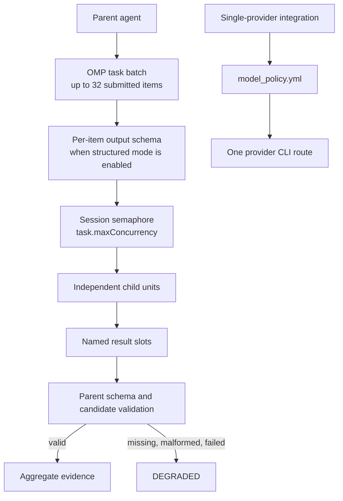

# Agent Workflow

> OMP-native interactive dispatch and retained single-provider integrations.

**Last Updated**: 2026-11-13

The batch-size ceiling is not an active-concurrency limit. OMP's session
semaphore enforces the configured `task.maxConcurrency`; the parent preserves
each named slot and marks invalid or unavailable reviews `DEGRADED`.
